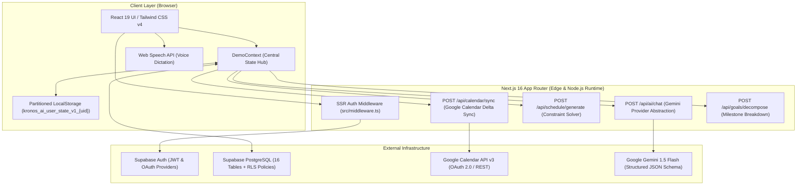
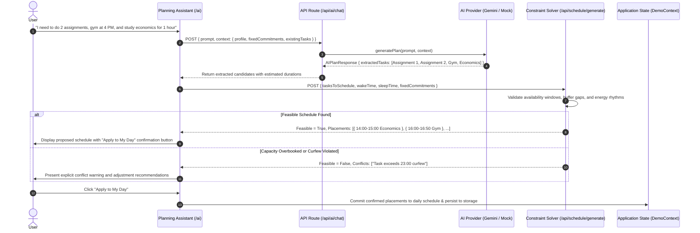
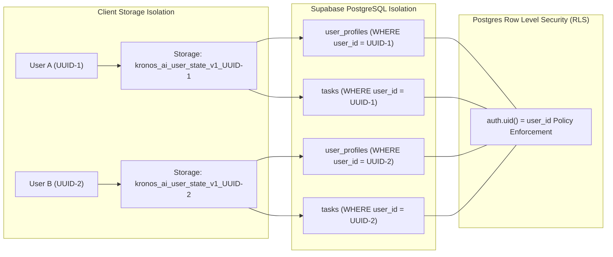
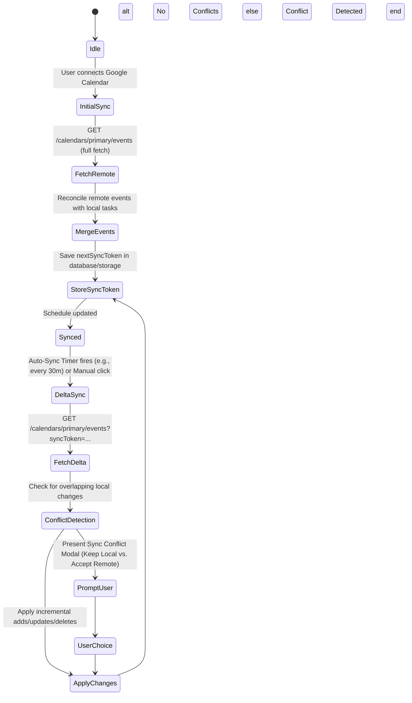

# Kronos AI — System Architecture & Engineering Blueprint

This document details the complete technical architecture, component hierarchy, state machines, data flow pipelines, and security mechanisms of **Kronos AI**.

---

## 1. High-Level System Architecture

Kronos AI employs a modern **hybrid architecture** combining Next.js 16 (React 19 Server & Client Components) with a remote Supabase Postgres backend and a purely functional, deterministic scheduling engine executed in TypeScript.



---

## 2. Next.js 16 App Router & Route Topology

Kronos AI strictly utilizes the **Next.js 16 App Router** convention with Route Groups `(auth)` and `(dashboard)` to isolate layout trees:

```
src/app/
├── (auth)/                    # Public Authentication Routes (Unauthenticated)
│   ├── layout.tsx             # Centered warm parchment auth shell
│   ├── login/page.tsx         # Supabase Email/Password + Google OAuth
│   ├── signup/page.tsx        # Registration with email confirmation
│   ├── forgot-password/       # Password recovery request form
│   └── reset-password/        # Password renewal with Supabase hash token
├── (dashboard)/               # Protected Application Workspaces (Authenticated)
│   ├── layout.tsx             # Persistent Topbar + Sidebar + BottomNav dock
│   ├── home/page.tsx          # Monthly Calendar & Agenda Command Center
│   ├── ai/page.tsx            # Planning Assistant Chat & Voice Composer
│   ├── my-day/page.tsx        # Daily Execution, Spotlight Ring & Rescheduler
│   ├── growth/page.tsx        # Flow Immersion Timers & Habit Tracking
│   └── profile/page.tsx       # Routine Preferences & Sync Settings
├── onboarding/page.tsx        # Multi-Step Guided Setup Wizard (Dynamic routes)
├── auth/callback/route.ts     # Supabase OAuth token exchange route
└── api/                       # Stateless Server API Endpoints
    ├── ai/chat/route.ts       # Intent parsing & task extraction
    ├── schedule/generate/     # Deterministic interval-packing constraint solver
    ├── calendar/sync/route.ts # Bi-directional calendar delta synchronization
    └── goals/decompose/       # Goal roadmap milestone decomposer
```

---

## 3. Dual-Engine Scheduling Architecture

One of the fundamental engineering innovations in Kronos AI is the strict separation between **unstructured human language understanding** and **mathematical scheduling validation**.



### Constraint Satisfaction Rules:
1. **Sleep Curfew**: All tasks must conclude before the user's `sleepTime` (default 23:00). Placements are never scheduled into sleeping hours.
2. **Fixed Commitment Inviolability**: Lectures, stakeholder meetings, and external calendar events cannot be overwritten or split.
3. **Transition Buffers**: Minimum 10-minute buffers are injected between heavy mental focus sessions and travel commitments.
4. **Energy Rhythm Alignment**: High-energy tasks (`energyLevel: 'high'`) are packed preferentially during the user's peak period (`mostProductivePeriod`: morning, afternoon, evening, or night).

---

## 4. Multi-Tenant Data Isolation & Security Architecture

Kronos AI guarantees complete data segregation between individual users across both browser memory and backend databases:



### Security Enforcement Layers:
- **SSR Middleware (`src/middleware.ts`)**: Every incoming request to protected routes is verified against Supabase Auth (`supabase.auth.getUser()`). Unauthorized requests are redirected to `/login?redirectTo=...` with authentication cookies cleanly cleared.
- **Service Role Key Shield**: The Supabase service role key is strictly forbidden in client bundles. Public endpoints only expose the unprivileged `NEXT_PUBLIC_SUPABASE_ANON_KEY`.
- **User Partitioned Storage**: `getUserStorageKey(userId)` scopes browser local storage to the authenticated user ID. When an account logs out or resets, foreign state remains unperturbed.

---

## 5. Calendar Integration & Delta Synchronization Pipeline

The calendar sync module (`src/lib/calendar/calendar-sync-adapter.ts`) interfaces with Google Calendar API v3 using incremental delta tokens:



### Auto-Sync Intervals:
The background sync interval is user-configurable from the Profile workspace (`src/app/(dashboard)/profile/page.tsx`):
- `15m` (Frequent active sync)
- `30m` (Default optimal battery/rate balance)
- `1h` / `6h` / `12h` / `1d` / `1w` (Low-frequency sync)
- `manual` (Only sync on demand)

### Persistent Authorization Architecture:
- **Refresh Token Preservation**: Subsequent re-authentications without explicit consent prompts omit the `refresh_token`. The server merges incoming tokens with the existing database record to prevent token loss.
- **Single-Flight Concurrency Mutex**: In-memory promise locks (`inFlightRefreshes` and `inFlightSyncs`) prevent race collisions when background auto-sync and user interactions occur concurrently.
- **Proactive & Reactive Expiration Handling**: Tokens expiring within 5 minutes are refreshed proactively; API calls returning HTTP 401 are automatically retried once after transparent token refresh.
- **Resilient Status Engine**: Only permanent revocation (`invalid_grant`) marks the connection in error. Temporary network outages or Google 5xx responses preserve the active connection state.
- **Zero-Flicker Client Hydration**: Connection status is cached in `localStorage` (`kronos_cached_sync_status`), preventing initial "offline" badge flicker during page reloads.

---

## 6. Behavioral Science State Machines

### Csíkszentmihályi Flow Immersion Engine
Focus sessions are tracked via a centralized interval timer (`useFocusTimer` inside `DemoContext`):
- State transitions: `idle` → `running` → `paused` → `interrupted` → `completed`.
- Post-session reflection modal prompts for:
  - Perceived Challenge ($1$ to $5$) vs. Perceived Skill ($1$ to $5$)
  - Resulting state: **Flow** (high challenge, high skill), **Anxiety** (high challenge, low skill), **Boredom** (low challenge, high skill), or **Steady**.
  - Distorted time perception assessment (*faster, normal, slower*).

### Non-Punitive Habit Discontinuity
Habits are anchored to daily routine cues (e.g., *"After morning coffee, open lecture slides for 2 minutes"*):
- Rather than a harsh binary streak counter that resets to zero after a missed day, Kronos tracks the **Self-Reported Habit Index (SRHI)** and **Context Consistency Score**.
- Allows life transition shifts (e.g., exams, moving, illness) without punitive psychological friction.
