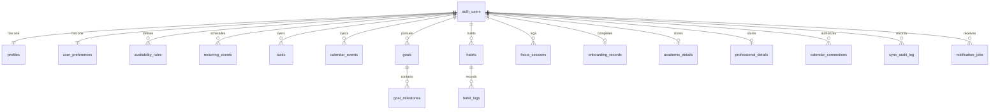

# Kronos AI — Database Architecture & Schema Specification

This document provides the authoritative technical reference for the **Supabase PostgreSQL database** schema powering Kronos AI, including table definitions, relationships, indexes, Row Level Security (RLS) policies, and data isolation mechanisms.

---

## 1. Schema Overview & Relational Topology

The database architecture is designed with strict multi-tenant isolation rooted in Supabase Auth's `auth.users` table. Every user-specific record explicitly references `user_id UUID REFERENCES auth.users(id) ON DELETE CASCADE`.



---

## 2. Relational Table Specifications

### 2.1 `profiles`
Represents the core user entity and links directly to Supabase Auth.
```sql
CREATE TABLE public.profiles (
  id UUID PRIMARY KEY REFERENCES auth.users(id) ON DELETE CASCADE,
  email TEXT NOT NULL UNIQUE,
  full_name TEXT,
  role TEXT NOT NULL DEFAULT 'student' CHECK (role IN ('student', 'professional', 'both')),
  avatar_url TEXT,
  headline TEXT,
  institution TEXT,
  created_at TIMESTAMPTZ DEFAULT NOW(),
  updated_at TIMESTAMPTZ DEFAULT NOW()
);
```

### 2.2 `user_preferences`
Stores daily circadian boundaries and cognitive focus preferences.
```sql
CREATE TABLE public.user_preferences (
  id UUID PRIMARY KEY DEFAULT gen_random_uuid(),
  user_id UUID NOT NULL REFERENCES auth.users(id) ON DELETE CASCADE UNIQUE,
  wake_time TIME NOT NULL DEFAULT '07:00:00',
  sleep_time TIME NOT NULL DEFAULT '23:00:00',
  most_productive_period TEXT NOT NULL DEFAULT 'morning' CHECK (most_productive_period IN ('morning', 'afternoon', 'evening', 'night')),
  preferred_focus_duration INT NOT NULL DEFAULT 45,
  preferred_break_duration INT NOT NULL DEFAULT 10,
  planning_style TEXT NOT NULL DEFAULT 'time-blocked' CHECK (planning_style IN ('structured', 'flexible', 'time-blocked')),
  sustainability_opt_in BOOLEAN DEFAULT FALSE,
  auto_sync_interval TEXT NOT NULL DEFAULT '30m' CHECK (auto_sync_interval IN ('15m', '30m', '1h', '6h', '12h', '1d', '1w', 'manual')),
  created_at TIMESTAMPTZ DEFAULT NOW(),
  updated_at TIMESTAMPTZ DEFAULT NOW()
);
```

### 2.3 `tasks`
Daily actionable tasks, study blocks, and scheduled items.
```sql
CREATE TABLE public.tasks (
  id UUID PRIMARY KEY DEFAULT gen_random_uuid(),
  user_id UUID NOT NULL REFERENCES auth.users(id) ON DELETE CASCADE,
  title TEXT NOT NULL,
  description TEXT,
  category TEXT NOT NULL CHECK (category IN ('study', 'work', 'personal', 'habit', 'errand', 'sustainability')),
  priority TEXT NOT NULL DEFAULT 'medium' CHECK (priority IN ('urgent', 'high', 'medium', 'low')),
  status TEXT NOT NULL DEFAULT 'todo' CHECK (status IN ('todo', 'in_progress', 'completed', 'rescheduled')),
  estimated_duration INT NOT NULL, -- duration in minutes
  start_time TIME,
  end_time TIME,
  scheduled_date DATE NOT NULL,
  deadline TIMESTAMPTZ,
  is_fixed BOOLEAN DEFAULT FALSE,
  energy_level TEXT DEFAULT 'medium' CHECK (energy_level IN ('high', 'medium', 'low')),
  subtasks JSONB DEFAULT '[]'::jsonb,
  goal_id UUID REFERENCES public.goals(id) ON DELETE SET NULL,
  google_event_id TEXT,
  created_at TIMESTAMPTZ DEFAULT NOW(),
  updated_at TIMESTAMPTZ DEFAULT NOW()
);
```

### 2.4 `calendar_events`
Fixed commitments, external imports, and schedule anchor blocks.
```sql
CREATE TABLE public.calendar_events (
  id UUID PRIMARY KEY DEFAULT gen_random_uuid(),
  user_id UUID NOT NULL REFERENCES auth.users(id) ON DELETE CASCADE,
  title TEXT NOT NULL,
  description TEXT,
  start_time TIME NOT NULL,
  end_time TIME NOT NULL,
  date DATE NOT NULL,
  category TEXT NOT NULL CHECK (category IN ('class', 'work', 'personal', 'habit', 'buffer')),
  is_fixed BOOLEAN DEFAULT TRUE,
  location TEXT,
  source TEXT NOT NULL DEFAULT 'kronos' CHECK (source IN ('kronos', 'google_calendar', 'timetable')),
  external_event_id TEXT,
  etag TEXT,
  created_at TIMESTAMPTZ DEFAULT NOW(),
  updated_at TIMESTAMPTZ DEFAULT NOW()
);
```

### 2.5 `goals` & `goal_milestones`
High-horizon objectives decomposed into phased milestones.
```sql
CREATE TABLE public.goals (
  id UUID PRIMARY KEY DEFAULT gen_random_uuid(),
  user_id UUID NOT NULL REFERENCES auth.users(id) ON DELETE CASCADE,
  title TEXT NOT NULL,
  category TEXT NOT NULL CHECK (category IN ('academic', 'career', 'skills', 'personal')),
  priority TEXT NOT NULL DEFAULT 'medium' CHECK (priority IN ('urgent', 'high', 'medium', 'low')),
  target_timeline TEXT NOT NULL,
  progress INT NOT NULL DEFAULT 0 CHECK (progress BETWEEN 0 AND 100),
  created_at TIMESTAMPTZ DEFAULT NOW(),
  updated_at TIMESTAMPTZ DEFAULT NOW()
);

CREATE TABLE public.goal_milestones (
  id UUID PRIMARY KEY DEFAULT gen_random_uuid(),
  goal_id UUID NOT NULL REFERENCES public.goals(id) ON DELETE CASCADE,
  title TEXT NOT NULL,
  due_date DATE,
  completed BOOLEAN DEFAULT FALSE,
  order_index INT NOT NULL DEFAULT 0,
  created_at TIMESTAMPTZ DEFAULT NOW()
);
```

### 2.6 `habits` & `habit_logs`
Behavioral routines anchored to daily contextual cues.
```sql
CREATE TABLE public.habits (
  id UUID PRIMARY KEY DEFAULT gen_random_uuid(),
  user_id UUID NOT NULL REFERENCES auth.users(id) ON DELETE CASCADE,
  title TEXT NOT NULL,
  cue TEXT NOT NULL,
  category TEXT NOT NULL CHECK (category IN ('focus', 'learning', 'health', 'mindfulness', 'eco')),
  frequency TEXT NOT NULL DEFAULT 'daily' CHECK (frequency IN ('daily', 'weekdays', '3x_week', 'weekly')),
  minimum_version TEXT,
  target_duration_minutes INT DEFAULT 15,
  current_streak INT DEFAULT 0,
  best_streak INT DEFAULT 0,
  automaticity_score INT DEFAULT 0 CHECK (automaticity_score BETWEEN 0 AND 100),
  context_consistency_score INT DEFAULT 85 CHECK (context_consistency_score BETWEEN 0 AND 100),
  created_at TIMESTAMPTZ DEFAULT NOW(),
  updated_at TIMESTAMPTZ DEFAULT NOW()
);

CREATE TABLE public.habit_logs (
  id UUID PRIMARY KEY DEFAULT gen_random_uuid(),
  habit_id UUID NOT NULL REFERENCES public.habits(id) ON DELETE CASCADE,
  user_id UUID NOT NULL REFERENCES auth.users(id) ON DELETE CASCADE,
  completed_at TIMESTAMPTZ DEFAULT NOW(),
  srhi_rating INT CHECK (srhi_rating BETWEEN 1 AND 7),
  notes TEXT
);
```

### 2.7 `focus_sessions`
Mihaly Csíkszentmihályi immersion sessions with subjective reflection metrics.
```sql
CREATE TABLE public.focus_sessions (
  id UUID PRIMARY KEY DEFAULT gen_random_uuid(),
  user_id UUID NOT NULL REFERENCES auth.users(id) ON DELETE CASCADE,
  task_title TEXT NOT NULL,
  duration_minutes INT NOT NULL,
  perceived_challenge INT NOT NULL CHECK (perceived_challenge BETWEEN 1 AND 5),
  perceived_skill INT NOT NULL CHECK (perceived_skill BETWEEN 1 AND 5),
  flow_state TEXT NOT NULL CHECK (flow_state IN ('flow', 'anxiety', 'boredom', 'steady')),
  time_distortion TEXT CHECK (time_distortion IN ('faster', 'normal', 'slower')),
  interruption_count INT DEFAULT 0,
  reflection_notes TEXT,
  created_at TIMESTAMPTZ DEFAULT NOW()
);
```

### 2.8 `calendar_connections` & `sync_audit_log`
OAuth credentials and synchronization audit trails.
```sql
CREATE TABLE public.calendar_connections (
  id UUID PRIMARY KEY DEFAULT gen_random_uuid(),
  user_id UUID NOT NULL REFERENCES auth.users(id) ON DELETE CASCADE UNIQUE,
  provider TEXT NOT NULL DEFAULT 'google',
  access_token TEXT,
  refresh_token TEXT,
  token_expires_at TIMESTAMPTZ,
  sync_token TEXT,
  calendar_id TEXT DEFAULT 'primary',
  last_synced_at TIMESTAMPTZ,
  created_at TIMESTAMPTZ DEFAULT NOW(),
  updated_at TIMESTAMPTZ DEFAULT NOW()
);

CREATE TABLE public.sync_audit_log (
  id UUID PRIMARY KEY DEFAULT gen_random_uuid(),
  user_id UUID NOT NULL REFERENCES auth.users(id) ON DELETE CASCADE,
  sync_type TEXT NOT NULL CHECK (sync_type IN ('auto', 'manual', 'initial', 'webhook')),
  events_pulled INT DEFAULT 0,
  events_pushed INT DEFAULT 0,
  conflicts_detected INT DEFAULT 0,
  status TEXT NOT NULL CHECK (status IN ('success', 'partial_error', 'failed')),
  error_message TEXT,
  created_at TIMESTAMPTZ DEFAULT NOW()
);
```

---

## 3. Database Indexes

To maintain instantaneous query speeds ($<10\text{ms}$) across daily agenda views:
```sql
CREATE INDEX idx_tasks_user_date ON public.tasks(user_id, scheduled_date);
CREATE INDEX idx_tasks_user_status ON public.tasks(user_id, status);
CREATE INDEX idx_cal_user_date ON public.calendar_events(user_id, date);
CREATE INDEX idx_habits_user ON public.habits(user_id);
CREATE INDEX idx_focus_user_created ON public.focus_sessions(user_id, created_at DESC);
CREATE INDEX idx_sync_audit_user ON public.sync_audit_log(user_id, created_at DESC);
```

---

## 4. Row Level Security (RLS) Policies

Row Level Security is enabled on **all 17 tables** without exception:

```sql
ALTER TABLE public.profiles ENABLE ROW LEVEL SECURITY;
ALTER TABLE public.user_preferences ENABLE ROW LEVEL SECURITY;
ALTER TABLE public.tasks ENABLE ROW LEVEL SECURITY;
ALTER TABLE public.calendar_events ENABLE ROW LEVEL SECURITY;
ALTER TABLE public.goals ENABLE ROW LEVEL SECURITY;
ALTER TABLE public.goal_milestones ENABLE ROW LEVEL SECURITY;
ALTER TABLE public.habits ENABLE ROW LEVEL SECURITY;
ALTER TABLE public.habit_logs ENABLE ROW LEVEL SECURITY;
ALTER TABLE public.focus_sessions ENABLE ROW LEVEL SECURITY;
ALTER TABLE public.calendar_connections ENABLE ROW LEVEL SECURITY;
ALTER TABLE public.sync_audit_log ENABLE ROW LEVEL SECURITY;

-- Standard tenant isolation policy applied across all user tables:
CREATE POLICY "Users own their profile" ON public.profiles FOR ALL USING (auth.uid() = id);
CREATE POLICY "Users own their preferences" ON public.user_preferences FOR ALL USING (auth.uid() = user_id);
CREATE POLICY "Users own their tasks" ON public.tasks FOR ALL USING (auth.uid() = user_id);
CREATE POLICY "Users own their calendar events" ON public.calendar_events FOR ALL USING (auth.uid() = user_id);
CREATE POLICY "Users own their goals" ON public.goals FOR ALL USING (auth.uid() = user_id);
CREATE POLICY "Users own their habits" ON public.habits FOR ALL USING (auth.uid() = user_id);
CREATE POLICY "Users own their focus sessions" ON public.focus_sessions FOR ALL USING (auth.uid() = user_id);
CREATE POLICY "Users own their calendar connections" ON public.calendar_connections FOR ALL USING (auth.uid() = user_id);
```

---

## 5. Migrations Manifest

| Migration File | Timestamp | Description |
| :--- | :--- | :--- |
| `20261102000000_initial_schema.sql` | 2026-11-02 | Foundational schema: profiles, tasks, calendar, habits, goals. |
| `20261105000000_production_evolution.sql` | 2026-11-05 | Auto-sync cadence columns, SRHI automaticity metrics, eco trackers. |
| `20261108000000_production_master_schema.sql` | 2026-11-08 | Complete unified master schema with strict RLS across all 17 tables. |
