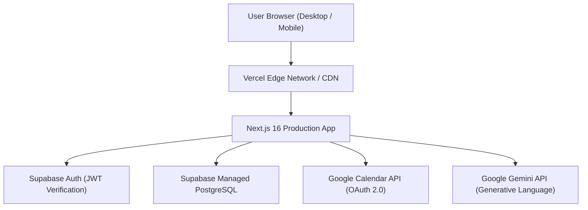

# Kronos AI — Production Deployment & Operations Guide

This guide provides step-by-step instructions for deploying Kronos AI to production infrastructure, configuring Supabase PostgreSQL databases, configuring Google Cloud OAuth credentials, and verifying post-deployment health.

---

## 1. Production Architecture Overview

The recommended production deployment stack for Kronos AI consists of:
- **Hosting & Compute**: [Vercel](https://vercel.com/) (Next.js 16 Edge & Serverless Runtime)
- **Database & Authentication**: [Supabase](https://supabase.com/) (Managed PostgreSQL 15+ & GoTrue Auth)
- **External APIs**: Google Calendar API v3 (Google Cloud Platform) & Google Gemini AI



---

## 2. Environment Variables Checklist

Ensure the following environment variables are configured in the Vercel Project Settings:

| Variable Name | Required | Scope | Purpose |
| :--- | :---: | :---: | :--- |
| `NEXT_PUBLIC_SUPABASE_URL` | **Yes** | Client & Server | Supabase project URL (e.g. `https://xxx.supabase.co`). |
| `NEXT_PUBLIC_SUPABASE_ANON_KEY` | **Yes** | Client & Server | Supabase anonymous public API key. |
| `NEXT_PUBLIC_DEMO_MODE` | **Yes** | Client & Server | Set to `false` in production to disable evaluator test mock fallbacks. |
| `NEXT_PUBLIC_APP_URL` | **Yes** | Client & Server | Public domain URL (e.g. `https://kronos-ai-theta.vercel.app`). |
| `GEMINI_API_KEY` | **Optional** | Server Only | Google Gemini API key for live LLM planning. |
| `GEMINI_MODEL` | **Optional** | Server Only | Model identifier (defaults to `gemini-1.5-flash`). |
| `GOOGLE_CLIENT_ID` | **Optional** | Server Only | Google Cloud OAuth Client ID for Calendar sync. |
| `GOOGLE_CLIENT_SECRET` | **Optional** | Server Only | Google Cloud OAuth Client Secret. |

> [!CAUTION]
> **Never** expose `SUPABASE_SERVICE_ROLE_KEY` or `GOOGLE_CLIENT_SECRET` in `NEXT_PUBLIC_` variables. Kronos AI includes build-time sanity checks that prevent deployment if secret keys are found in public bundles.

---

## 3. Database Migration Deployment (Supabase)

### Option A: Using the Supabase CLI
```bash
# Link local project to your remote Supabase instance
npx supabase link --project-ref your-project-ref

# Push migrations to production database
npx supabase db push
```

### Option B: Using the Supabase SQL Editor
1. Open your Supabase Dashboard → **SQL Editor**.
2. Copy and execute the contents of `supabase/migrations/20261108000000_production_master_schema.sql`.
3. Confirm that all 17 tables are created and Row Level Security is enabled.

---

## 4. Google Cloud Platform Configuration

To enable Google OAuth login and Google Calendar two-way synchronization:

1. Navigate to the [Google Cloud Console](https://console.cloud.google.com/).
2. Enable the **Google Calendar API** and **Google Tasks API** under **APIs & Services**.
3. Configure the **OAuth Consent Screen**:
   - User Type: External.
   - Publishing Status: **In Production** (avoids the 7-day testing refresh token expiry).
   - App Name: `Kronos AI`.
   - Scopes: `openid`, `email`, `profile`, `https://www.googleapis.com/auth/calendar.events`, `https://www.googleapis.com/auth/calendar.readonly`, `https://www.googleapis.com/auth/tasks`.
4. Create an **OAuth 2.0 Client ID**:
   - Application Type: Web Application.
   - Authorized JavaScript Origins:
     - `https://kronos-ai-theta.vercel.app`
     - `http://localhost:3001` (for local development)
   - Authorized Redirect URIs:
     - `https://kronos-ai-theta.vercel.app/auth/callback`
     - `https://knqrgeuesbnrinrgwchq.supabase.co/auth/v1/callback`
     - `http://localhost:3001/auth/callback`
5. Copy `Client ID` and `Client Secret` into both:
   - Supabase Dashboard → **Authentication** → **Providers** → **Google**.
   - Vercel Project Settings → **Environment Variables** (`GOOGLE_CLIENT_ID` & `GOOGLE_CLIENT_SECRET`) to enable autonomous background token refresh.

---

## 5. Vercel Deployment Instructions

1. Push your clean Git repository to GitHub:
   ```bash
   git push origin main
   ```
2. In the Vercel Dashboard, select **Import Git Repository**.
3. Configure the build parameters:
   - Framework Preset: **Next.js**
   - Root Directory: `./`
   - Build Command: `next build`
   - Output Directory: `.next`
4. Add all environment variables listed in Section 2.
5. Click **Deploy**.

---

## 6. Post-Deployment Verification Checklist

Once the production build completes, perform this rapid smoke test:

- [ ] **Home Page Routing**: Visiting the root URL (`/`) unauthenticated redirects to `/login`.
- [ ] **Account Registration**: Complete a test signup with a real email address and confirm verification email delivery.
- [ ] **Fresh State Verification**: Log in and verify that the newly created account has 0 tasks, 0 calendar events, and clean metrics.
- [ ] **Constraint Scheduling**: Submit a test intention in `/ai` and confirm that proposed start/end times do not exceed bedtime.
- [ ] **Google Calendar Sync**: Connect Google Calendar via the sync modal and verify external event import.
- [ ] **Mobile Ergonomics**: Inspect the site on a physical mobile device to confirm touch targets and bottom sheet interactions.
