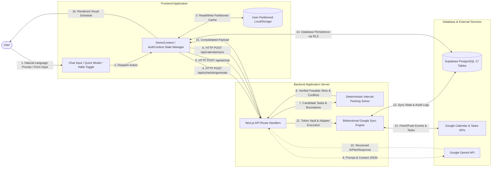
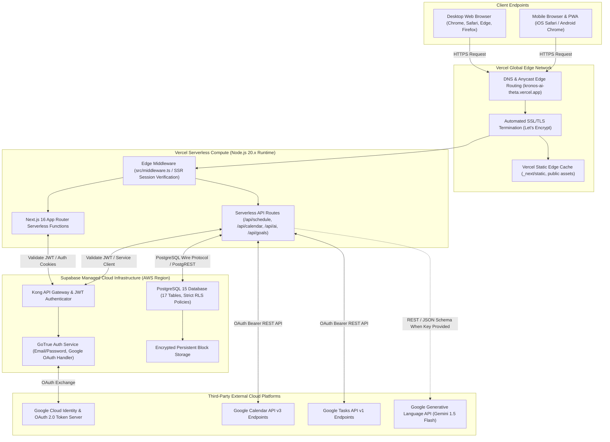
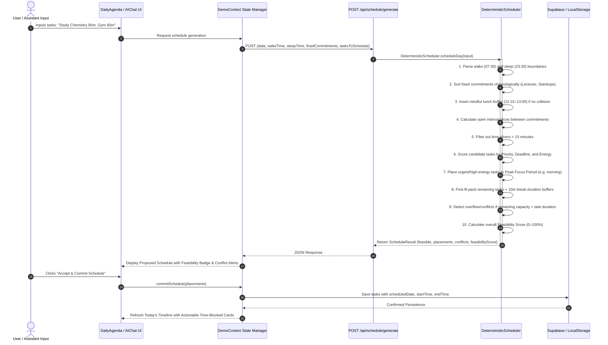
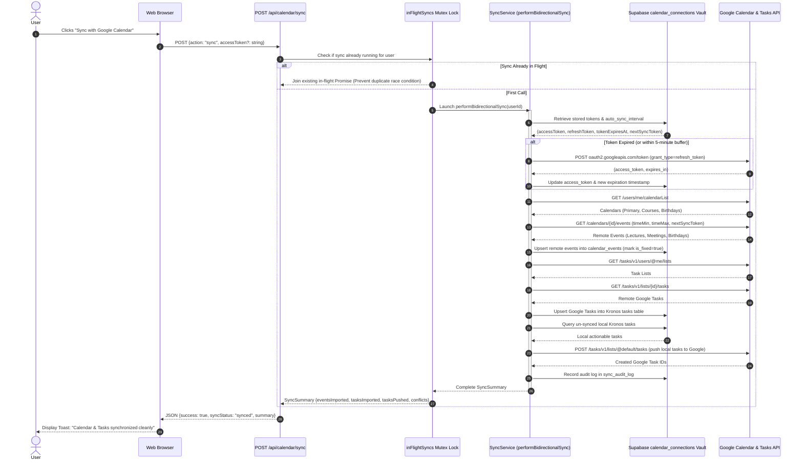

# Kronos AI — Architecture & Technical Diagrams Specification (A2)

This document contains the authoritative, verified **Mermaid diagrams** illustrating the architectural topology, data flow, entity relationships, scheduling sequences, and deployment infrastructure of **Kronos AI**. Every diagram strictly reflects the actual codebase implementation.

---

## 1. System Architecture Diagram

```mermaid
graph TD
    subgraph ClientTier ["Client Tier (Browser / Mobile / PWA)"]
        BrowserUI["Next.js 16 App Router UI (React 19 / Tailwind v4)"]
        WebSpeech["Web Speech API (Voice Dictation Engine)"]
        LocalCache["User-Scoped LocalStorage (Partitioned by User ID)"]
    end

    subgraph EdgeRouting ["Edge & Serverless Routing Layer"]
        SSRMiddleware["Next.js SSR Middleware (src/middleware.ts)"]
        AuthGuards["@supabase/ssr Session Verification & Cookie Auth"]
    end

    subgraph APIRoutes ["Backend API Routes (Next.js Server Runtime)"]
        APIChat["POST /api/ai/chat (Conversational Intent & Planning)"]
        APISchedule["POST /api/schedule/generate (Deterministic Solver)"]
        APICalendarSync["GET/POST/DELETE /api/calendar/sync (Sync Hub)"]
        APIGoalDecompose["POST /api/goals/decompose (Milestone Breakdown)"]
        AuthCallback["GET /auth/callback (OAuth Code Exchange)"]
    end

    subgraph CoreEngines ["Core Domain & Business Logic Engines"]
        DeterministicScheduler["DeterministicScheduler (src/lib/scheduler/engine.ts)"]
        AIProviderManager["AI Provider Layer (src/lib/ai/index.ts)"]
        SyncService["Sync Service (src/lib/calendar/sync-service.ts)"]
        DataService["Data Service Layer (src/lib/supabase/data-service.ts)"]
        EcoCalculator["Sustainability Engine (src/lib/sustainability/eco-calculator.ts)"]
    end

    subgraph ExternalServices ["External Infrastructure & Cloud Services"]
        SupabaseAuth["Supabase Auth (JWT & OAuth Provider)"]
        SupabaseDB["Supabase PostgreSQL (17 Tables + RLS Policies)"]
        GoogleCalendarAPI["Google Calendar API v3 (REST / nextSyncToken)"]
        GoogleTasksAPI["Google Tasks API v1 (REST / @default)"]
        GeminiAPI["Google Gemini 1.5 Flash (Structured JSON Schema) - [CONFIG REQUIRED]"]
    end

    %% Client Interactions
    BrowserUI --> SSRMiddleware
    BrowserUI --> LocalCache
    BrowserUI --> WebSpeech
    SSRMiddleware --> AuthGuards
    AuthGuards --> SupabaseAuth

    %% API Routing
    BrowserUI --> APIChat
    BrowserUI --> APISchedule
    BrowserUI --> APICalendarSync
    BrowserUI --> APIGoalDecompose
    BrowserUI --> AuthCallback

    %% Engine Handshakes
    APIChat --> AIProviderManager
    APISchedule --> DeterministicScheduler
    APICalendarSync --> SyncService
    APIGoalDecompose --> AIProviderManager
    AuthCallback --> SyncService
    BrowserUI --> DataService

    %% External Connections
    AIProviderManager -.->|When GEMINI_API_KEY Configured| GeminiAPI
    SyncService --> GoogleCalendarAPI
    SyncService --> GoogleTasksAPI
    SyncService --> SupabaseDB
    DataService --> SupabaseDB
    AuthGuards --> SupabaseDB

    classDef implemented fill:#e8f5e9,stroke:#2e7d32,stroke-width:2px;
    classDef planned fill:#fff3e0,stroke:#e65100,stroke-width:2px,stroke-dasharray: 5 5;
    class BrowserUI,WebSpeech,LocalCache,SSRMiddleware,AuthGuards,APIChat,APISchedule,APICalendarSync,APIGoalDecompose,AuthCallback,DeterministicScheduler,AIProviderManager,SyncService,DataService,EcoCalculator,SupabaseAuth,SupabaseDB,GoogleCalendarAPI,GoogleTasksAPI implemented;
    class GeminiAPI planned;
```

---

## 2. End-to-End Application Workflow Flowchart

```mermaid
flowchart TD
    Start([User Visits Kronos AI]) --> CheckAuth{Authenticated Session?}

    %% Unauthenticated Path
    CheckAuth -- No --> Landing[Landing / Login Page]
    Landing --> AuthChoice{Action}
    AuthChoice -- Email Login --> VerifyPass[Verify Supabase Auth Credentials]
    AuthChoice -- Sign Up --> CreateAcc[Create New Account]
    AuthChoice -- Google OAuth --> GoogleLogin[Google Identity Flow]
    GoogleLogin --> AuthCallbackRoute[OAuth Callback /auth/callback]
    AuthCallbackRoute --> ExchangeCode[Exchange Code for JWT & Hydrate Session]

    VerifyPass --> AuthSuccess[Authentication Succeeded]
    CreateAcc --> AuthSuccess
    ExchangeCode --> AuthSuccess

    %% Onboarding Check
    AuthSuccess --> CheckOnboarding{Onboarding Completed?}
    CheckAuth -- Yes --> CheckOnboarding

    CheckOnboarding -- No --> OnboardingWizard[11–12 Step Adaptive Onboarding Wizard]
    OnboardingWizard --> SelectRole[Select Role: Student / Professional / Both]
    SelectRole --> InputRoutine[Input Daily Routine: Wake, Sleep, Energy Peak]
    InputRoutine --> InputAcademicOrPro[Input Timetable / Recurring Meetings]
    InputAcademicOrPro --> SetGoalsHabits[Define Multi-Horizon Goals & Daily Habits]
    SetGoalsHabits --> SetPreferences[Set Focus Durations 25/45/60/90m & Breaks]
    SetPreferences --> SchedulePreview[Generate Initial Schedule Feasibility Preview]
    SchedulePreview --> SaveOnboarding[Save to Supabase onboarding_records & Profiles]
    SaveOnboarding --> Dashboard[Enter Home Workspace /home]

    CheckOnboarding -- Yes --> Dashboard

    %% Core Workspaces
    Dashboard --> NavChoice{Select Workspace}
    NavChoice -- Home --> HomeView[Monthly Calendar Grid + Daily Agenda Overview]
    NavChoice -- AI --> AIView[Conversational Assistant /ai]
    NavChoice -- My Day --> MyDayView[Execution Timeline & Check-off /my-day]
    NavChoice -- Growth --> GrowthView[Csíkszentmihályi Flow Timers & Habits /growth]
    NavChoice -- Profile --> ProfileView[User Profile & Google Sync Manager /profile]

    %% Conversational Daily Planning Loop
    AIView --> UserPrompt[User Inputs Natural Language Tasks]
    UserPrompt --> CheckAIConfig{Gemini API Configured?}
    CheckAIConfig -- Yes --> CallGemini[Google Gemini 1.5 Flash Structured Extraction]
    CheckAIConfig -- No --> CallMockOrReport[Report Configuration Requirement / Mock in Tests]
    CallGemini --> ParseTasks[Type-Safe Task Extraction & Priority Assignment]
    CallMockOrReport --> ParseTasks
    ParseTasks --> RunScheduler[Run Deterministic Scheduler Engine]
    RunScheduler --> FeasibilityCheck{Feasible Schedule?}
    FeasibilityCheck -- Yes --> ReviewPlan[Display Candidate Schedule with Feasibility Score]
    FeasibilityCheck -- No --> ShowConflicts[Display Specific Conflicts & Slack Deficit]
    ShowConflicts --> ResolveConflicts[User Adjusts Durations or Moves Tasks]
    ResolveConflicts --> ReviewPlan

    ReviewPlan --> UserApprove{User Approves Plan?}
    UserApprove -- Yes --> CommitPlan[Commit to Daily Agenda & Supabase/LocalStorage]
    UserApprove -- No --> DiscardPlan[Discard Suggestions]

    CommitPlan --> MyDayView
    MyDayView --> ExecuteTask[User Executes Task in Flow Session]
    ExecuteTask --> LogGrowth[Log Reflection: Flow / Steady / Boredom / Anxiety]
    LogGrowth --> GrowthView
```

---

## 3. Data Flow Diagram (DFD Level 1)

---

## 4. Database Entity-Relationship Diagram (ERD)

```mermaid
erDiagram
    auth_users ||--|| profiles : "has profile"
    auth_users ||--|| user_preferences : "defines preferences"
    auth_users ||--o{ availability_rules : "specifies"
    auth_users ||--o{ recurring_events : "schedules"
    auth_users ||--o{ tasks : "owns"
    auth_users ||--o{ calendar_events : "syncs"
    auth_users ||--o{ goals : "creates"
    goals ||--o{ goal_milestones : "breaks down into"
    auth_users ||--o{ habits : "builds"
    habits ||--o{ habit_logs : "records completion"
    auth_users ||--o{ focus_sessions : "logs immersion"
    auth_users ||--o| onboarding_records : "completes"
    auth_users ||--o| academic_details : "stores curriculum"
    auth_users ||--o| professional_details : "stores workplace info"
    auth_users ||--o{ calendar_connections : "authorizes tokens"
    auth_users ||--o{ sync_audit_log : "logs sync events"
    auth_users ||--o{ notification_jobs : "schedules alerts"

    profiles {
        uuid id PK
        text email
        text full_name
        text preferred_name
        text avatar_url
        text role
        text headline
        text institution_or_company
        timestamp created_at
        timestamp updated_at
    }

    user_preferences {
        uuid id PK
        uuid user_id FK
        text wake_time
        text sleep_time
        text most_productive_period
        integer preferred_focus_duration
        integer preferred_break_duration
        text planning_style
        boolean sustainability_opt_in
        timestamp created_at
        timestamp updated_at
    }

    availability_rules {
        uuid id PK
        uuid user_id FK
        integer day_of_week
        text available_start
        text available_end
        boolean is_active
        timestamp created_at
    }

    recurring_events {
        uuid id PK
        uuid user_id FK
        text title
        integer day_of_week
        text start_time
        text end_time
        text category
        text location
        boolean is_active
        timestamp created_at
    }

    tasks {
        uuid id PK
        uuid user_id FK
        text title
        text description
        text category
        text priority
        integer estimated_duration
        integer actual_duration
        text status
        date scheduled_date
        text start_time
        text end_time
        text deadline
        boolean is_fixed
        text tag
        text energy_level
        uuid goal_id FK
        text recurrence_rule
        text external_task_id
        timestamp created_at
        timestamp updated_at
    }

    calendar_events {
        uuid id PK
        uuid user_id FK
        text title
        text description
        date date
        text start_time
        text end_time
        text location
        text category
        boolean is_fixed
        text color
        text source
        text external_id
        text calendar_id
        boolean is_all_day
        timestamp created_at
        timestamp updated_at
    }

    goals {
        uuid id PK
        uuid user_id FK
        text title
        text description
        text category
        text horizon
        date target_date
        integer progress_percentage
        text status
        timestamp created_at
        timestamp updated_at
    }

    goal_milestones {
        uuid id PK
        uuid goal_id FK
        text title
        date due_date
        boolean completed
        integer sort_order
        timestamp created_at
    }

    habits {
        uuid id PK
        uuid user_id FK
        text name
        text description
        text frequency
        text cue
        text routine
        text reward
        integer target_duration
        text category
        text status
        integer current_streak
        integer best_streak
        timestamp created_at
        timestamp updated_at
    }

    habit_logs {
        uuid id PK
        uuid habit_id FK
        uuid user_id FK
        date log_date
        boolean completed
        integer duration_minutes
        text notes
        timestamp created_at
    }

    focus_sessions {
        uuid id PK
        uuid user_id FK
        uuid task_id FK
        integer target_duration
        integer actual_duration
        text reflection_state
        text notes
        timestamp started_at
        timestamp completed_at
    }

    onboarding_records {
        uuid id PK
        uuid user_id FK
        integer completed_step
        jsonb form_data
        boolean is_complete
        timestamp created_at
        timestamp updated_at
    }

    academic_details {
        uuid id PK
        uuid user_id FK
        text course_or_degree
        text semester_or_year
        text institution
        jsonb subjects
        jsonb timetable
        timestamp created_at
        timestamp updated_at
    }

    professional_details {
        uuid id PK
        uuid user_id FK
        text job_role
        text company
        text work_schedule_start
        text work_schedule_end
        jsonb recurring_meetings
        timestamp created_at
        timestamp updated_at
    }

    calendar_connections {
        uuid id PK
        uuid user_id FK
        text provider
        text access_token
        text refresh_token
        timestamp token_expires_at
        text sync_status
        timestamp last_synced_at
        text next_sync_token
        text google_email
        text scopes
        text auto_sync_interval
        timestamp created_at
        timestamp updated_at
    }

    sync_audit_log {
        uuid id PK
        uuid user_id FK
        text event_type
        text status
        text details
        integer items_synced
        timestamp created_at
    }

    notification_jobs {
        uuid id PK
        uuid user_id FK
        text title
        text message
        timestamp scheduled_for
        boolean dispatched
        text notification_type
        timestamp created_at
    }
```

---

## 5. Deployment Architecture Diagram

---

## 6. Deterministic Scheduling Engine Sequence Diagram

---

## 7. Google Calendar & Tasks Synchronization Sequence Diagram

