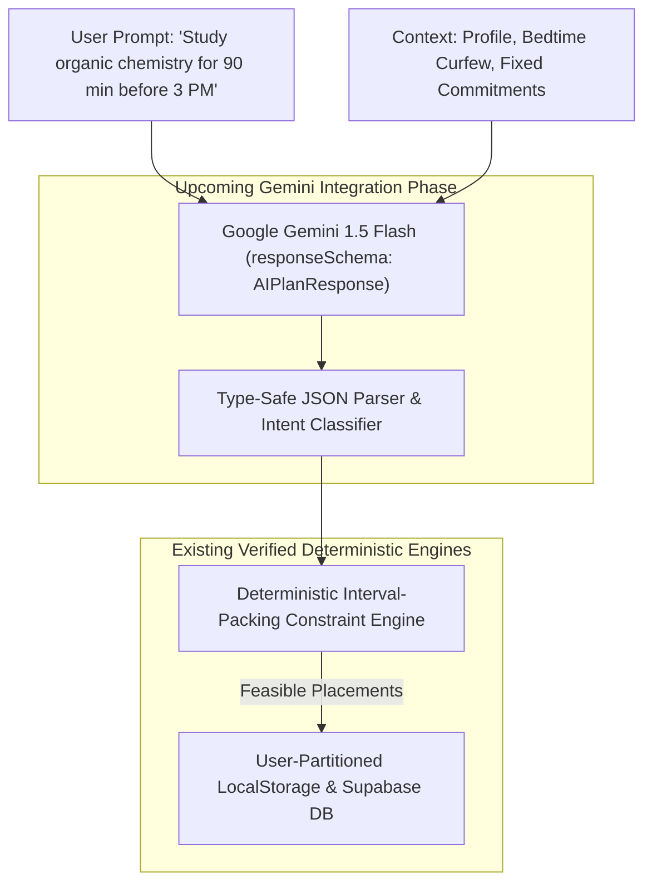

# Kronos AI — Next Phase: Google Gemini API Integration Blueprint

This document defines the technical roadmap, architectural interfaces, prompt engineering schemas, and implementation sequence for the **upcoming Gemini API integration phase**.

---

## 1. Architectural Readiness: What Is Already Prepared

Kronos AI was intentionally engineered from Day 1 to make Gemini API integration seamless and isolated. The platform already contains:

1. **Provider Abstraction Interface (`src/lib/ai/provider.ts`)**:
   Standardized `AIProvider` TypeScript contract requiring `generatePlan(userPrompt, context): Promise<AIPlanResponse>`.
2. **Standardized Response Schema (`src/lib/ai/types.ts`)**:
   Formal TypeScript interfaces for `ExtractedTask`, `ExtractedHabit`, `ExtractedGoal`, `AIIntent`, and `AIPlanResponse`.
3. **Prepared Gemini Provider (`src/lib/ai/gemini-provider.ts`)**:
   Complete implementation of `GeminiProvider` utilizing Google Generative AI REST endpoints with native `responseSchema` structured JSON enforcement.
4. **Deterministic Constraint Engine Handshake (`src/context/demo-context.tsx`)**:
   The application state pipeline is already wired to feed extracted tasks from `/api/ai/chat` directly into `/api/schedule/generate` for temporal feasibility verification.



---

## 2. Gemini System Prompt & Structured Output Schema

The integration will utilize Gemini's native structured JSON mode (`response_mime_type: "application/json"` with `response_schema`):

### System Prompt Specification:
```text
You are Kronos AI, an expert personal productivity and time-management assistant.
Your goal is to parse user intentions, extract tasks with realistic durations, and assign sensible priorities.
You MUST consider the user's profile:
- Role: {role}
- Waking target: {wakeTime}
- Sleep boundary: {sleepTime}
- Peak focus period: {mostProductivePeriod}
- Preferred focus length: {preferredFocusDuration} min
- Fixed commitments: {fixedCommitments}

CRITICAL CONSTRAINTS:
1. Never hallucinate overlapping slots over fixed commitments.
2. Return strictly valid JSON adhering to the specified schema.
3. CONVERSATIONAL & GENERAL QUERIES: If the user message is a conversational query, greeting, or question (e.g. "what are you doing", "who are you", "what can you do", "hello", "how are you"), you MUST set intent to "general_query", provide a helpful, natural conversational reply in "explanation", and return an EMPTY ARRAY [] for "extractedTasks". NEVER create a task from a casual question!
4. Only extract tasks if the user explicitly mentions tasks, study blocks, meetings, or activities they want to do or reschedule.
5. Be calm, practical, and supportive.
```

### JSON Response Schema (`responseSchema`):
```json
{
  "type": "OBJECT",
  "properties": {
    "intent": {
      "type": "STRING",
      "enum": [
        "create_daily_schedule",
        "add_task",
        "reschedule_missed",
        "urgent_interruption",
        "goal_decomposition",
        "general_query",
        "clarification_needed"
      ]
    },
    "explanation": { "type": "STRING" },
    "extractedTasks": {
      "type": "ARRAY",
      "items": {
        "type": "OBJECT",
        "properties": {
          "title": { "type": "STRING" },
          "description": { "type": "STRING" },
          "category": {
            "type": "STRING",
            "enum": ["study", "work", "personal", "habit", "errand", "sustainability"]
          },
          "priority": {
            "type": "STRING",
            "enum": ["urgent", "high", "medium", "low"]
          },
          "estimatedDuration": { "type": "INTEGER" },
          "startTime": { "type": "STRING" },
          "endTime": { "type": "STRING" },
          "deadline": { "type": "STRING" },
          "isFixed": { "type": "BOOLEAN" },
          "energyLevel": {
            "type": "STRING",
            "enum": ["high", "medium", "low"]
          }
        },
        "required": ["title", "category", "priority", "estimatedDuration", "isFixed"]
      }
    },
    "detectedPreferences": {
      "type": "OBJECT",
      "properties": {
        "preferred_study_duration": { "type": "INTEGER" },
        "preferred_break_duration": { "type": "INTEGER" },
        "preferred_exercise_time": { "type": "STRING" }
      }
    },
    "requiresClarification": { "type": "BOOLEAN" },
    "clarificationQuestion": { "type": "STRING" }
  },
  "required": ["intent", "explanation", "extractedTasks", "requiresClarification"]
}
```

---

## 3. Step-by-Step Implementation Sequence

When authorized to begin the Gemini integration phase, execute the following steps:

### Step 1: SDK Installation & Environment Activation
- Add official `@google/genai` or `@google/generative-ai` SDK (or verify direct REST client).
- Add `GEMINI_API_KEY` into `.env.local`.

### Step 2: Route Handler Verification
- Test `src/app/api/ai/chat/route.ts` with live Gemini credentials.
- Verify that `isAIConfigured()` evaluates to `true` and returns HTTP 200 with structured plan.

### Step 3: UI Status Transition
- In `src/app/(dashboard)/ai/page.tsx`, the status badge automatically switches from `"Prototype AI Mode"` to `"Gemini Live Connected"`.
- The briefing banner transitions to confirm active LLM inference.

### Step 4: Streaming & Latency Optimization
- Evaluate Server-Sent Events (SSE) streaming for natural conversational typing effects while preserving JSON schema extraction upon stream completion.

### Step 5: Multi-Turn Memory & Preference Retention
- Connect `src/lib/ai/memory.ts` to persist extracted user rhythms (e.g., *"Prefers 50-minute study blocks on Tuesdays"*) directly into Supabase `user_preferences`.

---

## 4. Acceptance Criteria for Gemini Phase

1. Casual conversational questions (*"Who created you?"*, *"What can you do?"*) yield natural dialogue without generating blank calendar tasks.
2. Complex multi-task prompts (*"I have 3 chapters of biology to read, need to run 5k at sunset, and finish my resume"*) correctly extract 3 discrete tasks with accurate durations.
3. Extracted tasks pass directly through `/api/schedule/generate` without schema errors or type mismatches.
4. If an invalid or revoked API key is supplied, the system gracefully displays an actionable configuration banner without crashing the dashboard.
